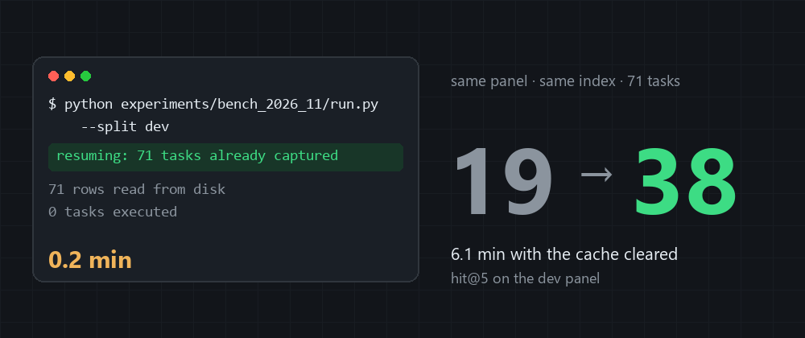
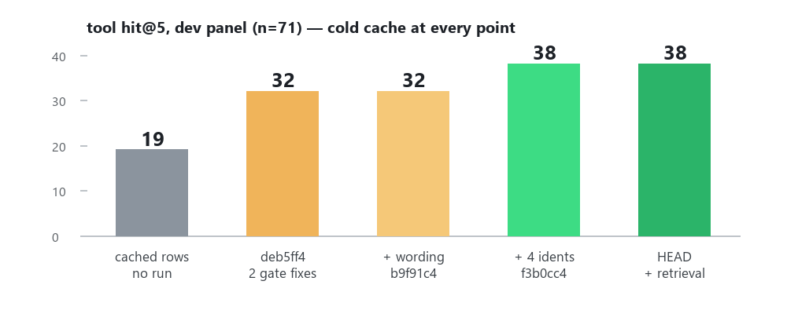

> **Part 5 of: [MSCodeBase Intelligence — Field Notes](https://github.com/ManSio/mscodebase-intelligence/tree/main/docs/blog)** — *[Part 1: PageRank](https://dev.to/mansio/i-measured-pagerank-token-savings-on-a-real-codebase-the-result-will-surprise-you-5bnj) · [Part 2: Silent Vector Contamination](https://dev.to/mansio/the-silent-vector-contamination-bug-why-your-concurrent-embeddings-might-be-lying-to-you-5fg7) · [Part 3: Verify-on-Read](https://dev.to/mansio/the-mechanical-vs-the-semantic-what-happens-when-ai-memory-is-wrong-38ko) · [Part 4: Bootstrap Pipeline](https://dev.to/mansio/from-a-test-suite-trace-to-a-search-signal-the-bootstrap-pipeline-story-407b) · **Part 5 (this post)**

> **TL;DR:** a benchmark that finishes in 0.2 minutes did not run. Mine reprinted four-day-old numbers from a capture file committed to git, and I published them three times as a design trade-off. With the cache cleared, the same panel reads **19 → 32 → 38** across five code states — and six of those tasks came back from one two-item list slice.



You have shipped this: a test suite that goes green in four seconds, a CI job that always passes, a dashboard that hasn't moved in a week. Nothing is broken, exactly. Nothing ran, either.

Mine was a benchmark. On 14 November it finished in **0.2 minutes** and printed the same four numbers it had printed four days earlier — every digit, every arm. I looked at the table, felt pleased that the result was *stable*, and moved on.

It was reading a file. A 71-row capture of finished tasks, committed to git. The harness resumed from it, skipped all 71 tasks, and reprinted November's answers. The line that said so — `resuming: 71 tasks already captured` — was the third line of its own output. I read the table at the bottom and not the sentence at the top.

What makes this worth a post is not the cache. It is what the cache was hiding: for four days I had published a number that described a product I no longer shipped — and that number said something flattering. My tool was *honest*, and honesty cost recall. A design trade-off I could defend in a comment thread. It was a disk read.

This post is the 48 hours in which that number came apart: the re-run, the four bugs it was covering, and the one task it still costs.

## What I set out to test

I build MSCodeBase, an MCP server that indexes a repository and answers questions about the code. The claim behind it is narrow and testable: *it finds things grep can't.*

The benchmark asks it to localize a commit. The query is the commit message, the gold is `git show --name-only` — the files that commit actually touched — and the corpus is a worktree frozen at a base commit, so the fix being searched for is not in the index. Three corpora: my own repo frozen at `7c2c7a3`, plus `psf/requests` and `sqlalchemy`, which I did not write. A fourth, `pallets/click`, joins later as a genuinely untouched test.

The panel is 174 commits in `(B, HEAD]`. 66 tasks whose answer files were created *after* `B` are unsolvable by construction — dropped, and counted, so the denominator stays visible. 108 solvable, split 71 dev / 37 sealed by date. The panel hash is in `MANIFEST.sha256` and it has not changed through any of this.

Four arms, same corpus, same base:

| arm | what it is |
|---|---|
| `tool` | the product as it ships |
| `tool + neighbours` | the same call with `include_neighbours=true` — the refusal bypassed |
| `search` | the BM25/hybrid channel alone, the baseline that matters |
| `grep` | message words against file contents, the floor |

## What I measured on 10 November

The dev split, 71 solvable tasks:

| arm | hit@1 | hit@5 | any@8 |
|---|---:|---:|---:|
| tool (default) | 12 | **19** | 23 |
| tool + neighbours | 24 | 38 | 44 |
| search channel alone | 11 | 22 | 29 |
| grep (floor) | 0 | 2 | 6 |

These are the numbers in the committed capture — the same four rows the replay prints today. (The `E68` log entry was written from an earlier run of the same panel and says 37 and 24; the capture and `REPORT.md` agree on 38 and 22, and the capture is the thing that was replayed, so I quote the capture.)

Both pre-registered bars failed: **P1 FAIL (default 0.268 < 0.35)**, and on dev the default answers 19 where the plain search channel answers 22 — the log's own words are "5 below plain search", which uses its `search = 24` row.

So I did what a benchmark owner should do: I classified the misses. All 52 of them:

```plaintext
36  abstain, zero rows     -> names in the message do not exist in the corpus
11  outside top-8
 4  rank 6-8
 1  outside top-8 (answer)
```

**36 of 52 were refusals**, not bad ranking and not a chunking artefact. The gate took the first identifier it extracted from the commit message, found zero occurrences of that token, and withheld the eight neighbours it had already computed.

## The conclusion I published

The refusal is a policy I chose on purpose: **never present an unverified row as an answer.** A commit message names things the commit *introduces*; an API that did not exist in the corpus at `B` cannot occur in it. The gate was doing exactly what it was built to do, and the benchmark was cold about it, because a refusal does not help a reader find the file.

So I wrote this:

> This is a policy decision (honesty vs recall), not a ranking defect.

And the report priced it: **-33 tasks of 108 solvable** (dev 19 vs 38, sealed 7 vs 21). Then the same 19 went into a log entry that said "`identical`" before and after a fix, and into another that said "19/71 **both ways**".

One run on 10 November. Three publications after it. Zero re-runs.

It is a satisfying sentence. It says: my tool is not worse, it is *honest*, and honesty costs recall. It is also exactly what you write when the alternative — that your gate is broken — would require deleting a paragraph you have already published.

## The run that took 0.2 minutes

On 14 November I re-ran the panel. It finished in **0.2 minutes** and printed every digit from four days earlier.

The harness resumes. That is a feature — a run that dies at task 16 should not start over — and it is implemented the obvious way:

```python
partial = HERE / f"results_{args.split}.partial.jsonl"
done = set()
if partial.is_file():
    for line in partial.read_text(encoding="utf-8").splitlines():
        old = json.loads(line); rows.append(old); done.add(old["id"])
    print(f"resuming: {len(done)} tasks already captured")
for task in tasks:
    if task["id"] in done:
        continue
```

Note the `print`. The harness told me, in plain text, on line three of its own output: **`resuming: 71 tasks already captured`**. I read the table at the bottom and skipped the sentence at the top. That is the whole failure, and it is not subtle.

`results_dev.partial.jsonl` has been tracked in git since commit `e033edc` — 71 rows, one per task. Every clone made between 10 and 14 November started with November's answers already "captured", and `run.py` faithfully skipped the work and printed them back. The file is still tracked; it now holds today's rows, and the harness does not read it without `--resume`.

I did not notice for four days, because the numbers looked *stable*. Stable is exactly what a cache is.

## Three reads of one panel

Same machine, same index, same 71 tasks, cache cleared where it says so:

| what was measured | tool hit@5 | wall clock |
|---|---:|---:|
| captured rows from 10 Nov, replayed on HEAD | 19 | 0.2 min |
| code at `deb5ff4` (11 Nov), cache cleared | **32** | 6.1 min |
| HEAD (14 Nov), cache cleared | **38** | 6.1 min |



The first row is the tell. **19 came from a file, not from a run.** The same command, on the same HEAD code, prints 19 in twelve seconds — because those numbers were written by an older product and stored on disk. Twelve seconds is how long it takes to read 71 answers back.

Paired at hit@5, task by task: cached rows vs `deb5ff4` — **13 up, 0 down**; `deb5ff4` vs HEAD — **6 up, 0 down**.

I have to stop that sentence there, because it is only true at hit@5. At `any@8` one task does go down between `deb5ff4` and HEAD, and on `sqlalchemy` one commit that used to be found is no longer found. There is no run in this post where nothing regressed; there are runs where the *headline metric* did not.

The control arms did not move at all: `search` 11/22/29 and `grep` 0/2/6 in all three reads, task by task identical. Whatever moved, moved in the tool's own gate, not in retrieval.

## The four ways the gate was wrong

The gate is one small thing: if no identifier from the question occurs in the corpus, print "not found" instead of a neighbour list. Four defects in that path:

1. **A Gerrit `Change-Id` counted as an identifier** (`3a3f46a`). A 40-character hash never occurs in source, so every `sqlalchemy` commit carrying one was refused. `0 → 11` of 40.
2. **The refusal was decided by the first token** (`deb5ff4`). On commit prose that token is an annotation: `_orm.registry=0` next to `Declarative=785`. 13 of 40 commits answered nothing while the rows existed. `11 → 17`.
3. **The warning called a real hit a neighbour** (`b9f91c4`). Before the fix above, the branch was unreachable; after it, the message printed "the results below are neighbours, not matches" over an exact match. The policy was honest and the text explaining it was not.
4. **The grep channel counted two identifiers out of four** (`f3b0cc4`). `_identifiers()` returns up to `_MAX_IDS = 4`; the loop took `identifiers[:2]`. A name in slot 3 or 4 that *did* occur could not stop the refusal, so the answer was emptied while the file that answers it sat in the index.

Two of the four shipped with a test that failed first: slots 1–2 as a control (pass both ways), slots 3–4 failing on the old code and passing after; and `test_recovered_answer_is_not_called_neighbours`. For the other two I have the commit message and the before/after number, not a red test, and I am not going to claim otherwise.

Defect 3 changes no score at all — it only changes what the tool says. It is in this list because a gate that lies in its output is the same bug as a gate that lies in its ranking, and it took a reviewer to see it.

## What the external repos say

Two repositories I did not write. No cache here — the external runner rebuilds every task from git, every run:

| | `psf/requests` (25) | `sqlalchemy` (40) |
|---|---:|---:|
| tool at `deb5ff4` | 12 | 17 (twice) |
| tool at HEAD | **13** | **18** |
| search channel (control) | 15 | 18 |
| grep (floor) | 19 | 20 |

`deb5ff4` reproduces the November numbers exactly — 12 and 17, the values in my facts file, and 17 twice in two control runs.

The +1 on `requests` is one task up and none down. The +1 on `sqlalchemy` is **two up and one down** — a commit the old gate found is now missed — and the rejects are not individually explained.

grep still wins on both, 19 vs 13 and 20 vs 18. That is a ranking gap. It is not a cache, it is not a policy, and I have not fixed it.

## Out of sample, on a repo I had never opened

The objection I could not answer with more of the same panel: *you found the defects on `sqlalchemy` and measured the fix on your own repo.*

That is fair, and it is worth being precise about who is contaminated. `sqlalchemy` is where defects 1 and 2 were **discovered**. `requests` was only used to **verify** a fix designed elsewhere. The dev panel is the product's own code. So exactly one of my external numbers was ever quasi-clean, and it was worth one task.

So I cloned `pallets/click` for this test and nothing else. Corpus frozen at `7df2f82` (2026-07-16), index built once (138 files, 2,149 chunks, 71 s), 35 solvable commits, same panel builder, same two code states:

| click (35 solvable) | hit@1 | hit@5 |
|---|---:|---:|
| tool at `deb5ff4` | 21 | 26 |
| tool at HEAD | **22** | **29** |
| neighbours (bypass), HEAD | 23 | 30 |
| search channel | 2 | 14 |
| grep | 17 | 29 |

Three tasks up, none down. At hit@5 that is **+8.6%**, against **+8.5%** on the dev panel (6 of 71): the same rate, on a repository that had no part in designing the fix. On `sqlalchemy` and `requests` the identical change was worth one task each — the difference is the corpus, not the code.

The control arms did not move (30 / 14 / 29 in both runs), so this is the gate again, not retrieval. And grep ties the tool at hit@5 here (29 each) while losing at hit@1 (17 vs 22) — the first corpus in this series where the tool is not behind grep.

This is the only number in the post that nothing I wrote before it could have shaped.

## What each fix is actually worth

The first version of this post said I could not attribute the +19. Then I ran the intermediate commits: cold cache, same machine, same index, same day, 71 tasks each, none of them resumed.

| point | what changed in the product | tool hit@5 | wall clock |
|---|---|---:|---:|
| cached rows | nothing — a replay of 10 Nov | 19 | 0.2 min |
| `deb5ff4` | hashes are not identifiers; refusal needs *no* identifier | **32** | 6.0 min |
| `b9f91c4` | the warning stops calling a real hit a neighbour | 32 | 13.5 min |
| `f3b0cc4` | the grep channel counts all four identifiers, not two | **38** | 7.7 min |
| HEAD | + ONNX batch padding, + vector-schema width | 38 | 6.1 min |

*Wall clock here is not a performance claim: the 13.5-minute cross-check shared the machine with the full test suite and several ONNX start timeouts.*

Read it as a decomposition:

- **The wording fix is worth zero**, which is exactly what it should be: it changes what the tool says, not which rows it returns. A message-only change that moved the score would have been a bug in the benchmark.
- **The identifier fix is worth all six tasks.** `identifiers[:2]` was throwing away answers that the third or fourth name in the message would have justified.
- **The two retrieval commits are worth zero here.** ONNX batch padding and vector-schema width cannot move a text-index panel, and they didn't.
- **The 13 tasks between the cached rows and `deb5ff4` belong to the two November gate fixes as a pair.** Splitting them costs two more runs of six minutes; I did not do it, so they stay a pair.

Six of those nineteen tasks — the part I had published as a design trade-off — were at the bottom of a list slice. The other thirteen belong to the two November fixes I still did not split.

## What the policy actually costs

The `19` and the `38` are not the same kind of thing, and that is the second reason this is hard to write. At HEAD the honest arm and the bypass arm are the same number:

```plaintext
dev, HEAD (n=71)      hit@1  hit@5  any@8   MRR
tool (abstain on)        23     38     43   0.416
tool + neighbours        23     38     44   0.417
search channel           11     22     29   0.239
grep                      0      2      6   0.051
```

**hit@5 identical, `any@8` differs by one task.** That is the measured cost of the refusal policy: one task in seventy-one. The report's -33 was measured against the 10 November code and does not describe what ships today.

`one task` and `eighteen` are not the same claim, and I have published both in the last four days.

## Reproduce

One panel, two runners. A cold run is the default now — the cache is opt-in:

```bash
git worktree add ../wt-deb5ff4 deb5ff4536cdd2f960faba686e35b4b4c4443250
cd ../wt-deb5ff4
git rev-parse HEAD                      # must print deb5ff4536...
python experiments/bench_2026_11/run.py --split dev
```

Two guards before you trust the output:

1. `resuming:` must not appear anywhere in it. If it does, you are reading a file, not a run.
2. A run that finishes in under three minutes did not execute 71 tasks.

The `cd` and the `rev-parse` are not decoration. Miss the `cd` and you run the harness of whatever repository you were standing in — which is exactly how my first attempt at this series produced two "runs" of a commit that was never checked out.

The panel also needs its corpus. `run.py` hardcodes it near the top (line 36) to a `bench-B` worktree sitting next to the repository — a worktree of this repository at the frozen base, indexed once:

```bash
git worktree add ../bench-B 7c2c7a3c6417539bc08f807d6790fe6e722d3a84
python scripts/reindex_text_only.py --project ../bench-B
```

Keep the corpus anywhere you like, but change that line, or the run stops with `project_path does not exist`.

The panel is frozen: `tasks.jsonl` hashes to `71395d45…`, the first line of `MANIFEST.sha256`. Hash its **blob**, not your checkout: on Windows `core.autocrlf` rewrites line endings, and a PowerShell pipe re-encodes the stream, so the obvious `git show … | git hash-object` returns a different digest and makes it look like the panel was swapped:

```bash
python -c "import hashlib,subprocess as s;print(hashlib.sha256(s.run(['git','show','HEAD:experiments/bench_2026_11/tasks.jsonl'],capture_output=True).stdout).hexdigest())"
```

The external arms need no capture at all: `external.py` rebuilds every task from `git log` and `git show` on each run, which is why they are the part of this benchmark that cannot replay an old answer.

## Red Team

- **The dev panel is not held out — and now I can say by how much.** `sqlalchemy` is where two defects were *found* (contaminated), `requests` only verified a fix designed elsewhere, and the dev panel is my own code. The untouched test is `click`: +3 tasks, 3 up / 0 down, +8.6% against +8.5% on dev. That does not make the dev number out-of-sample; it makes the *effect* reproduce somewhere the fixes never saw.
- **My harness's noise floor is at least one task.** Two identical control runs at `deb5ff4`, cache cleared both times, gave the neighbours arm 37 and then 38 at hit@5. The tool arm held at 32. Two runs are not a distribution, but they are enough to say the floor is *at least* one task — and the +1 on each external repo sits exactly on it. The paired directions are what carry the rest: **13 up / 0 down** (p ≈ 0.0001) and **6 up / 0 down** (p ≈ 0.016) by a one-sided sign test, and `click` adds **3 up / 0 down** (p ≈ 0.125).
- **Environment is not excluded, but it is bounded.** Every cold run except HEAD fell back to a degraded ONNX path ("server did not start in 60s") — including `f3b0cc4`, which fell back and still scored 38, exactly like HEAD without the fallback. The fallback does not move this panel; the search arm is identical in every run. What I did not do is force a fallback on HEAD to close it symmetrically.
- **The 19 was a real measurement once.** It describes the product on 10 November. It was never a measurement of the code I shipped on 11 November, and both facts are true at the same time.
- **CIs overlap.** 32/71 is [0.34, 0.57], 38/71 is [0.42, 0.65]. The paired direction is what carries the claim, not the interval.
- **n=25 on `requests`.** One task is four percentage points. The +1 there is the smallest possible effect — it could be luck.
- **A committed capture was a reproducibility landmine.** Between 10 and 14 November, anyone who cloned this repo and ran the harness got my November answers in 0.2 minutes, with a `resuming` line they could read past just as easily as I did. The file is still tracked; the harness no longer reads it without `--resume`.

## What I changed

The harness now refuses to replay itself. Reuse is opt-in:

```bash
python experiments/bench_2026_11/run.py --split dev            # runs all 71 tasks
python experiments/bench_2026_11/run.py --split dev --resume   # continues a dead run
```

Without `--resume` the stale capture is printed and dropped, because `run.py` appends to it and an appended run would silently mix two products. There is a test for that behaviour, and it fails when the flag is removed — I checked by removing it.

## What I'd do differently

Read a run's first line before its last table. If it finished in twelve seconds, it did not run.

The rest is downstream of that: my benchmark is not dishonest. It did exactly what it was told — skip the work you already have. I told it, in a file, in git, and then read its output as a measurement of today.

**Does your benchmark resume from a capture? When did you last delete it?**

---

## Acknowledgments

A huge thank you to everyone who engages with these posts in the comments. Your feedback, real-world observations, counter-examples, and benchmark numbers directly shape these experiments. This kind of open technical critique is what keeps engineering honest.

---

## A note on how this was written

Every experiment, bug, failure, and idea here is mine — I earned them the hard way, in production, in public. AI worked as my editor: it helped me structure thoughts and polish my English. It did not invent the facts, because it has none of its own.

No AI detectors were consulted in the making of this disclosure. They have enough trouble agreeing on what I am.

---

> **Disclaimer & Status:** draft (source-material for the article). This is not a "feature advertisement", but an honest engineering story: figures are reproducible, weak points are named, and unaddressed risks are listed in the "Red Team" and "What each fix is actually worth" sections.

*Raw artifacts: `experiments/bench_2026_11/` — the November capture as committed in `e033edc`, the fresh run outputs, both external result files and `REPORT.md`. The controls ran in a worktree at `deb5ff4`, `b9f91c4` and `f3b0cc4`; the panel hash in `MANIFEST.sha256` was unchanged, so no task was re-barred. Invalid runs, the old cache and the failed gates sit on disk next to the passing ones.*
