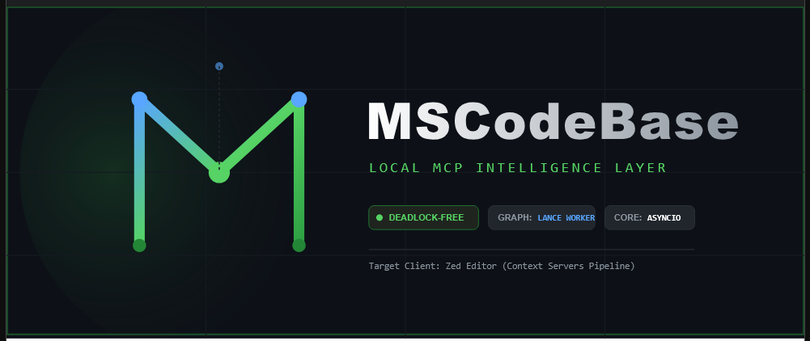

# Installing MSCodebase Intelligence

<p align="center">
  
</p>

[🇬🇧 English](INSTALL.md) • [🇷🇺 Русский](../ru/INSTALL.md) • [🇨🇳 中文](../zh/INSTALL.md)

> Rewritten 2026-11-08. The server is a local MCP server. **OpenCode is the primary
> host**; the Zed extension is still supported. Model downloads are optional — the
> default install is text-first and needs no embeddings, GPU or network.

---

## 1. Requirements

| Component | Requirement |
|---|---|
| OS | Windows 10+ (validated platform), Linux (CI), macOS |
| Python | **3.14+** (only 3.14 is tested) |
| RAM | 4 GB; 8 GB+ if you enable local models |
| Disk | ~500 MB without models; up to ~2 GB with GGUF models |
| Host | OpenCode (primary) or Zed, or any MCP client |
| Optional | LM Studio / Ollama / llama.cpp for rerank and the legacy dense path |

Docker and WSL are not required on the development machine. The container build is a
deployment option (`deploy/docker/`).

## 2. Full install

```bash
cd <repo-root>
python install.py          # interactive: venv, pip, optional llama.cpp + models
```

Windows also has `install.bat`; Linux/macOS have `install.sh`. The installer:

1. checks Python and the environment;
2. creates/updates the virtual environment and installs dependencies;
3. optionally downloads llama.cpp and GGUF models;
4. copies the code into the installed extension directory;
5. writes `uninstall.bat`.

Without models the server still answers code questions — search falls back to
SQLite FTS5/BM25 plus the graph.

## 3. Update loop (the part people get wrong)

The installed copy lives outside the repository:

```
%LOCALAPPDATA%\Zed\extensions\mscodebase-intelligence
```

The directory name is historical; OpenCode launches the same venv
(`…\venv\Scripts\mscodebase-mcp.exe -u -m src.main`). Therefore:

```bash
python install.py --sync-only    # copy code, drop __pycache__, no pip/models
# then restart the host: the OpenCode session (or the Zed window)
```

`--sync-only` (alias `--sync`) is the fast path after every source change. Skipping
the restart leaves the old process running; skipping the sync leaves old code in the
installed location. Both are required.

## 4. Connect a host

**OpenCode** — declare a local MCP server pointing at the installed venv:

```jsonc
"mcp": {
  "mscodebase-intelligence": {
    "type": "local",
    "command": ["<ext-dir>/venv/Scripts/mscodebase-mcp.exe", "-u", "-m", "src.main"],
    "environment": {
      "PYTHONPATH": "<ext-dir>",
      "PROJECT_PATH": "${workspaceRoot}",
      "PYTHONUTF8": "1"
    }
  }
}
```

**Zed** — the extension reads the same directory; no extra configuration beyond the
extension itself.

**Claude Code / VS Code / Cursor** — copy the shape from `adapters/clients/` and fill
in the venv path, repo path and project path. See
[CLIENTS.md](CLIENTS.md) for the full matrix.

## 5. Verify

From the agent panel, in this order:

```
tool_help()                                   # profile + visible/hidden tools
get_health_report()                           # index, providers, resources
codebase(action="index", path="status")       # chunks > 0?
```

If the text index is missing or stale:

```bash
python scripts/reindex_text_only.py --project .   # chunks + graph, no embeddings
python scripts/rebuild_graph.py                   # graph only
```

Then restart the server so the new process opens the rebuilt stores. Measured numbers
for this repository are in [FACTS.md](../FACTS.md).

## 6. Optional providers

| Provider | Why | Where |
|---|---|---|
| llama.cpp (GGUF) | on-demand rerank, legacy dense path | `LLAMA_CPP_PORT` (8080), reranker 8081 |
| LM Studio | embeddings/rerank over HTTP | `LM_STUDIO_HOST:1234` |
| Ollama | embeddings/rerank over HTTP | `OLLAMA_HOST:11434` |
| basedpyright | the six `lsp_*` tools | PATH or extension venv |

None of them is needed for the default text-first answer. Provider settings:
[CONFIGURATION.md](CONFIGURATION.md).

## 7. Uninstall

```bash
./uninstall.bat             # Windows
python install.py --uninstall
```

This removes the installed extension copy. Project data under
`%LOCALAPPDATA%/mscodebase/` and the project's `.mscodebase/chunks.db` are separate;
delete them manually if you want a clean slate.

## 8. Troubleshooting

| Symptom | Likely cause |
|---|---|
| Tool you expect is missing | `core` profile — run `tool_help()`, switch to `full` |
| "Nothing found" for any query | empty index — check `codebase(action="index", path="status")` |
| New code has no effect | no `--sync-only` and/or no host restart |
| Server starts, tools time out | provider or LSP hanging — see [GRACEFUL_DEGRADATION.md](GRACEFUL_DEGRADATION.md) |
| Windows console windows flashing | subprocess without `CREATE_NO_WINDOW` — see [ZED_WINDOWS_QUIRKS.md](ZED_WINDOWS_QUIRKS.md) |
