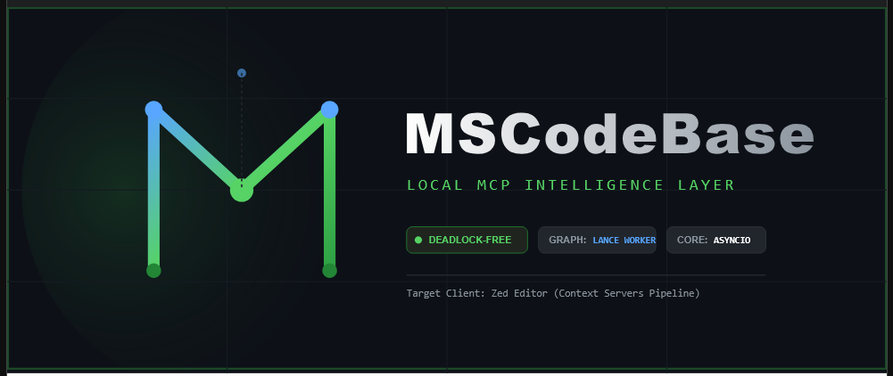

# Установка MSCodebase Intelligence

> Перевод: 2026-11-08, источник — docs/en/INSTALL.md. Английская версия — канон.

<p align="center">
  
</p>

[🇬🇧 English](../en/INSTALL.md) • [🇷🇺 Русский](INSTALL.md) • [🇨🇳 中文](../zh/INSTALL.md)

> Переписано 2026-11-08. Сервер — локальный MCP-сервер. **OpenCode — основной
> хост**; расширение Zed по-прежнему поддерживается. Загрузка моделей опциональна —
> дефолтная установка text-first и не требует эмбеддингов, GPU или сети.

---

## 1. Требования

| Компонент | Требование |
|---|---|
| ОС | Windows 10+ (проверенная платформа), Linux (CI), macOS |
| Python | **3.14+** (тестируется только 3.14) |
| RAM | 4 ГБ; 8 ГБ+ при включении локальных моделей |
| Диск | ~500 МБ без моделей; до ~2 ГБ с моделями GGUF |
| Хост | OpenCode (основной) или Zed, либо любой MCP-клиент |
| Опционально | LM Studio / Ollama / llama.cpp для реранка и legacy dense-пути |

Docker и WSL на машине разработчика не нужны. Сборка контейнера — вариант
развёртывания (`deploy/docker/`).

## 2. Полная установка

```bash
cd <repo-root>
python install.py          # interactive: venv, pip, optional llama.cpp + models
```

В Windows также есть `install.bat`; в Linux/macOS — `install.sh`. Установщик:

1. проверяет Python и окружение;
2. создаёт/обновляет виртуальное окружение и ставит зависимости;
3. опционально скачивает llama.cpp и модели GGUF;
4. копирует код в каталог установленного расширения;
5. пишет `uninstall.bat`.

Без моделей сервер всё равно отвечает на вопросы о коде — поиск откатывается на
SQLite FTS5/BM25 плюс граф.

## 3. Цикл обновления (часть, которую обычно путают)

Установленная копия живёт вне репозитория:

```
%LOCALAPPDATA%\Zed\extensions\mscodebase-intelligence
```

Имя каталога историческое; OpenCode запускает тот же venv
(`…\venv\Scripts\mscodebase-mcp.exe -u -m src.main`). Поэтому:

```bash
python install.py --sync-only    # copy code, drop __pycache__, no pip/models
# then restart the host: the OpenCode session (or the Zed window)
```

`--sync-only` (алиас `--sync`) — быстрый путь после каждого изменения исходников.
Пропуск перезапуска оставляет работать старый процесс; пропуск синхронизации
оставляет в установленном каталоге старый код. Нужно и то, и другое.

## 4. Подключение хоста

**OpenCode** — объявите локальный MCP-сервер, указывающий на установленный venv:

```jsonc
"mcp": {
  "mscodebase-intelligence": {
    "type": "local",
    "command": ["<ext-dir>/venv/Scripts/mscodebase-mcp.exe", "-u", "-m", "src.main"],
    "environment": {
      "PYTHONPATH": "<ext-dir>",
      "PROJECT_PATH": "${workspaceRoot}",
      "PYTHONUTF8": "1"
    }
  }
}
```

**Zed** — расширение читает тот же каталог; дополнительной настройки сверх самого
расширения не требуется.

**Claude Code / VS Code / Cursor** — скопируйте форму из `adapters/clients/` и
подставьте путь к venv, путь к репозиторию и путь к проекту. Полная матрица —
в [CLIENTS.md](CLIENTS.md).

## 5. Проверка

Из панели агента, в этом порядке:

```
tool_help()                                   # profile + visible/hidden tools
get_health_report()                           # index, providers, resources
codebase(action="index", path="status")       # chunks > 0?
```

Если текстовый индекс отсутствует или устарел:

```bash
python scripts/reindex_text_only.py --project .   # chunks + graph, no embeddings
python scripts/rebuild_graph.py                   # graph only
```

Затем перезапустите сервер, чтобы новый процесс открыл пересобранные хранилища.
Замеренные числа для этого репозитория — в [FACTS.md](../FACTS.md).

## 6. Опциональные провайдеры

| Провайдер | Зачем | Где |
|---|---|---|
| llama.cpp (GGUF) | реранк по запросу, legacy dense-путь | `LLAMA_CPP_PORT` (8080), реранкер 8081 |
| LM Studio | эмбеддинги/реранк по HTTP | `LM_STUDIO_HOST:1234` |
| Ollama | эмбеддинги/реранк по HTTP | `OLLAMA_HOST:11434` |
| basedpyright | шесть инструментов `lsp_*` | PATH или venv расширения |

Ни один из них не нужен для дефолтного text-first ответа. Настройки провайдеров:
[CONFIGURATION.md](CONFIGURATION.md).

## 7. Удаление

```bash
./uninstall.bat             # Windows
python install.py --uninstall
```

Это удаляет установленную копию расширения. Данные проекта в
`%LOCALAPPDATA%/mscodebase/` и `.mscodebase/chunks.db` проекта — отдельно;
удалите их вручную, если нужен чистый лист.

## 8. Диагностика проблем

| Симптом | Вероятная причина |
|---|---|
| Ожидаемого инструмента нет | профиль `core` — выполните `tool_help()`, переключитесь на `full` |
| «Ничего не найдено» на любой запрос | пустой индекс — проверьте `codebase(action="index", path="status")` |
| Новый код не даёт эффекта | нет `--sync-only` и/или перезапуска хоста |
| Сервер стартует, инструменты уходят в таймаут | завис провайдер или LSP — см. [GRACEFUL_DEGRADATION.md](GRACEFUL_DEGRADATION.md) |
| Мигают консольные окна в Windows | подпроцесс без `CREATE_NO_WINDOW` — см. [ZED_WINDOWS_QUIRKS.md](ZED_WINDOWS_QUIRKS.md) |
