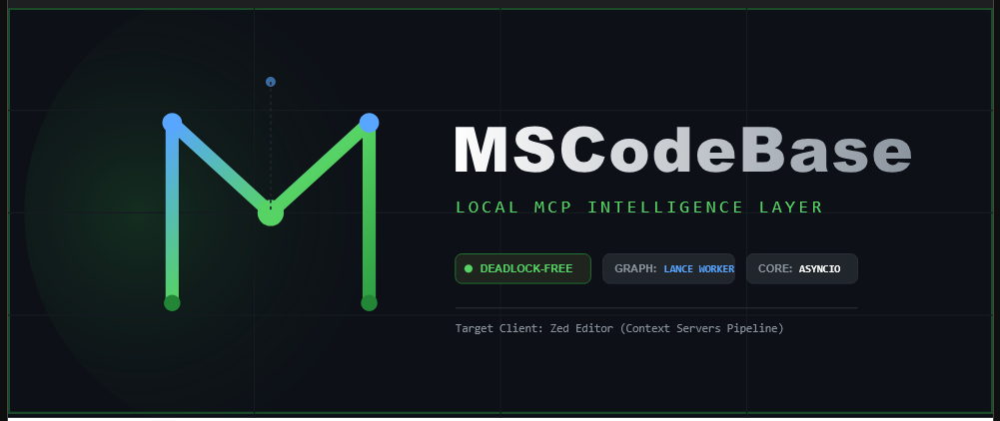

<div align="center">



[English](../../README.md) · [Русский](README.md) · [中文](../zh/README.md)

# MSCodebase Intelligence

**Локальный code intelligence для Zed: лексический поиск, граф вызовов, impact analysis, память проекта и безопасные write-tools через MCP.**

[](https://www.python.org/downloads/)
[](https://opensource.org/licenses/MIT)
[](https://modelcontextprotocol.io/)
[](https://zed.dev/)
[](https://github.com/ManSio/mscodebase-intelligence/actions/workflows/ci.yml)

*Обновлено: 2026-10-25. Английская страница — канон; этот перевод может отставать.*

</div>

---

## Что это

MSCodebase Intelligence — **локальный MCP-сервер**, который даёт AI-ассистенту
в Zed обоснованное представление о кодовой базе. Это не чат-модель и не замена
LSP редактора. Его задачи:

- Где определён символ, кто его вызывает и что сломается при изменении?
- Какие файлы относятся к вопросу — в коде, тестах или документации?
- Что проект уже решил и какие инциденты всё ещё открыты?
- Можно ли безопасно preview/apply rename, move, replace?

Текущий дефолт — **text-first retrieval**: SQLite FTS5/BM25 плюс индекс
Tree-sitter/PropertyGraph. Провайдеры эмбеддингов и реранкеров существуют, но
они опциональны и не нужны для дефолтного пути. Это осознанный выбор: сервер
остаётся полезным offline, latency предсказуема, а векторная БД не становится
единственной точкой отказа.

## Что работает сегодня

| Область | Что делает | Примечание |
|---|---|---|
| Поиск по коду | BM25/FTS5 по чанкам; exact-symbol и path-сигналы; опциональное расширение по графу | `search_code` |
| Поиск по документации | Отдельный FTS-канал `docs/**`, включается автоматически при сильном BM25-разрыве | Без LLM-роутера |
| Символы | Определение, callers/callees, references, impact, structural search | `get_symbol_info`, `impact_analysis`, `structural_search` |
| Граф | PropertyGraph файлов/символов: call, import, assignment, decorator, override | Пересборка: `scripts/rebuild_graph.py` |
| Память проекта | ADR, инциденты, known issues, retract/supersede | `intel_*` |
| Безопасные записи | Rename, move, delete, replace, insert с preview/impact | `codebase(action=...)` |
| Диагностика | Runtime passport, health, index status, logs, jobs | `debug_runtime_passport`, `get_health_report` |
| LSP rename | Cross-file rename через basedpyright + fallback SymbolIndex | Только rename |

## Качество поиска: измеренное, с границами

Числа без методики бесполезны. Ниже — внутренняя **панель из 48 запросов**
(33 реальных вопроса по проекту + 15 вопросов из docstring), чистый индекс без
`experiments/**`, граф присутствует. Это не универсальный benchmark и не
описание всех языков/репозиториев.

| Путь | hit@1 | hit@5 | Что означает |
|---|---:|---:|---|
| Код, quality | 0.825 | 0.900 | 33/40 code-вопросов вернули нужный файл первым |
| Docs, exact path | 0.000 | 0.125 | Gold указывает `docs/en/X`, поиск часто отдаёт `docs/ru/X` |
| Docs, same basename | 0.750 | 0.750 | Перевод считается тем же документом |
| Общий quality | 0.688 | 0.750 | Код и docs ровно так, как размечена панель |
| Общий auto docs route | 0.792 | 0.875 | BM25-margin router + docs-канал; переводы нормализованы |
| Fast | 0.542 | 0.729 | Ниже качество, ниже latency; для exact/simple lookup |

Чего эти числа **не** означают:

- Это **не** 95% точности. Ни одна статическая схема на этой панели не дала
  такого результата. Two-channel repo map (code PageRank + docs BM25) дал около
  40% / 62% / 73% покрытия gold-файлов при 1k / 2k / 4k токенов и идеальном
  routing; PageRank отдельно — около 33% / 55% / 68% на code-запросах. Это
  инструмент выбора контекста, не замена поиску.
- Это **не** значит, что любой локальный реранкер улучшает результат. Несколько
  моделей были измерены и отклонены: они снижали hit@1 или добавляли
  неприемлемую latency на этой панели.
- Это **не** значит, что docs-канал сломан. Он часто отдаёт правильный документ
  на другом языке (`docs/ru/X` вместо `docs/en/X`). Это вопрос канонизации gold,
  а не retrieval.

Панель, сырые прогоны, гипотезы и summary лежат в `experiments/`. Это
воспроизводимый lab notebook, а не маркетинговый текст.

## Как работает поиск

Дефолтный путь детерминированный:

1. **Parse/index** — файлы → чанки + PropertyGraph.
2. **Retrieve** — SQLite FTS5/BM25, symbol/path-сигналы, опционально соседи графа.
3. **Rank/clean** — опциональный on-demand rerank, exact-name boost и
   дедупликация символов. RRF/MMR/dense fusion относятся к опциональному
   LanceDB/vector path, а не к каждому дефолтному запросу.
4. **Docs routing** — если лучший docs-score превышает лучший code-score на
   настраиваемый margin (`MSCODEBASE_DOCS_MARGIN`, default `4.0`).
5. **Return** — ранжированные чанки/файлы с metadata. `intent="docs"` или
   `intent="code"` переопределяют автоматический выбор.

В routing нет LLM. Это один дополнительный FTS-запрос и сравнение scores:
локально, объяснимо, дешево.

Опциональные слои:

- Embedding-провайдеры (llama.cpp GGUF, ONNX, LM Studio/Ollama) для vector candidates.
- On-demand rerank при настроенном провайдере.
- Graph expansion и PageRank-подобный repo ranking.

При `MSCODEBASE_DENSE_OFF=true` (текущий default) сервер не требует embedding
server для code/docs запросов.

## Быстрый старт

Требования: Windows — валидированная платформа; Python 3.14+; Zed с расширением
`mscodebase-intelligence`.

```bash
cd <repo-root>
python install.py
# code-only sync без вопросов:
python install.py --sync
# CI-режим без вопросов:
python install.py --yes
```

`install.py` копирует сервер в extension directory Zed, ставит зависимости,
опционально готовит модели и пишет MCP-конфиг. После завершения перезапустите Zed.

Проверка из agent panel:

```text
debug_runtime_passport()
intel_get_runtime_status()
codebase(action="index", path="status")
```

Если граф пустой, а чанки есть — пересоберите только граф (без векторов):

```bash
python scripts/rebuild_graph.py
```

Если индекс устарел/пуст — пересоберите текст и граф:

```bash
python scripts/reindex_text_only.py --project .
```

Затем перезапустите MCP/Zed, чтобы новый процесс открыл пересобранные stores.

## Инструменты

Сервер регистрирует **66 инструментов** в четырёх группах; `execute_script`
добавляет один опциональный инструмент при
`MSCODEBASE_EXECUTE_SCRIPT_ENABLED=true`. Default allowlist показывает выбранное подмножество;
скрытые инструменты включаются через `MSCODEBASE_MCP_TOOLS` (пустая строка —
показать все). Точный набор виден в startup-логе MCP и в
`intel_get_runtime_status`.

| Группа | Примеры | Назначение |
|---|---|---|
| Поиск и анализ | `search_code`, `plan_search`, `get_symbol_info`, `impact_analysis`, `structural_search`, `graph_query` | Код, символы, связи, impact |
| Индекс и система | `codebase(action="index"...)`, `notify_change`, `read_live_file`, `get_health_report`, `get_logs` | Свежесть и диагностика индекса |
| Intelligence | `intel_get_runtime_status`, `intel_get_project_memory`, `intel_log_incident`, `intel_analyze_incident`, `intel_predict_root_cause` | Память, инциденты, runtime |
| Записи и lifecycle | `codebase(action="rename"...)`, `move`, `safe_delete`, `replace`, `insert_before/after`, `ack_impact` | Preview/apply безопасных изменений |
| Dev | `bump_version`, `auto_update_docs`, `install_git_hooks`, `generate_docs` | Обслуживание репозитория |

`codebase` — hub: `action` выбирает index, git или write. Смотрите tool schema
в MCP-клиенте, а не рукописный список, который может устареть.

## Архитектура

```text
Zed
 │
 ├── built-in LSP (autocomplete, diagnostics)
 │
 └── MCP client
      │
      ▼
 MSCodebase MCP server
   ├── Search      SQLite FTS5/BM25, symbol/path signals, optional graph
   ├── Graph       PropertyGraph: calls, imports, assignments, decorators, overrides
   ├── Index       parser → chunks → FTS5 + graph; freshness checks
   ├── Memory      ADRs, incidents, known issues, retract/supersede
   ├── Writes      rename/move/delete/replace/insert with impact guards
   ├── Diagnostics runtime passport, health, jobs, logs, telemetry
   └── Optional    embedding providers, reranker, LSP rename
```

Канонические данные лежат вне репозитория:

- `%LOCALAPPDATA%/mscodebase/projects/<hash>/` — per-project graph, memory, jobs.
- `%LOCALAPPDATA%/mscodebase/logs/` — логи сервера.
- `<project>/.mscodebase/chunks.db` — text chunk store для Phase 3.

LanceDB остаётся частью legacy/optional vector path; для дефолтного text-first
режима она не требуется.

## Конфигурация

Все настройки — environment variables с defaults в `src/config/settings.py`.
Главные для поиска:

| Переменная | Default | Эффект |
|---|---|---|
| `MSCODEBASE_DENSE_OFF` | `true` | Пропустить dense/vector retrieval; FTS5, symbols, graph |
| `MSCODEBASE_SQLITE_CHUNKS` | `true` | Использовать SQLite/FTS5 chunk store |
| `MSCODEBASE_DEMOTE_NON_CODE` | `false` | Понижать tests/docs/experiments в fused pool |
| `MSCODEBASE_DEMOTE_INTENT_AWARE` | `false` | Не понижать docs при docs-intent |
| `MSCODEBASE_DOCS_MARGIN` | `4.0` | Порог auto docs routing (docs − code score) |
| `MSCODEBASE_ONDEMAND_RERANK` | `true` | Опциональный live rerank; нужен провайдер |
| `MSCODEBASE_P3_ANCHOR` | `false` | Module-head anchors; без reranker дают latency |
| `MSCODEBASE_MCP_TOOLS` | default set | Allowlist инструментов; пусто = все |

`experiments/**` намеренно исключён из индекса. Там frozen-панели и run
artifacts; их индексация раньше заставляла BM25 возвращать саму панель вместо
кода. Файлы при этом остаются в git.

## Поддерживаемые языки

Python — основной, полностью проверенный язык. Tree-sitter parsing покрывает
JavaScript, TypeScript/TSX, Rust, Go, Java, C#, Ruby, PHP, Kotlin, Swift, C,
C++, Scala и Dart. SQL, YAML, TOML, HTML, CSS и HCL/Terraform индексируются как
контекст, без такого же покрытия call graph. Глубина графа и data-flow зависит
от grammar; не все языки дают одинаковые типы рёбер.

## Ограничения и известные проблемы

Это осознанные, документированные границы, а не скрытое поведение:

- **Docs gold vs язык:** docs-канал может вернуть `docs/ru/X.md`, когда gold —
  `docs/en/X.md`. Документ правильный, exact-path метрика — нет. При оценке
  переводов нормализуйте по basename.
- **Auto docs routing эвристичен:** margin настраивается и подобран на панели 48
  запросов. Code-запрос с сильными docs-словами может уйти в docs;
  `intent="code"` — escape hatch.
- **Graph rebuild отдельно от text reindex:** при `MSCODEBASE_DENSE_OFF=true`
  полный vector reindex намеренно блокируется. Для графа —
  `scripts/rebuild_graph.py`, для чанков — `scripts/reindex_text_only.py`.
- **Нет заявки на 95%:** статический retrieval и протестированные локальные
  реранкеры не дали этого на внутренней панели. LLM planner/agent loop — другой
  эксперимент и не дефолтный путь.
- **Fast mode — не quality mode:** быстрее, но заметно менее точен на смешанных
  natural-language вопросах. Для exact names и известных путей.
- **Видимые tools — allowlist:** «66 tools» в исходниках не значит, что все 64
  видны конкретному клиенту; проверяйте `MSCODEBASE_MCP_TOOLS`.

## Как сообщать о баге

Полезный отчёт — маленький эксперимент, а не только число. Укажите:

1. Точный tool call и параметры (`query`, `mode`, `intent`, `limit`).
2. `debug_runtime_passport()` и `codebase(action="index", path="status")`.
3. Пересобирался ли граф (`scripts/rebuild_graph.py`) и были ли включены
   `MSCODEBASE_DENSE_OFF` / `MSCODEBASE_ONDEMAND_RERANK`.
4. Ожидаемый файл и фактически возвращённые файлы; exact-path или same-basename
   (переводы считаются тем же документом).
5. Минимальный запрос для воспроизведения и хвост лога из
   `%LOCALAPPDATA%/mscodebase/logs/`.

Это позволяет отделить четыре разные проблемы, которые выглядят одинаково:
плохой ranking, отсутствующий candidate, stale/empty index и gold-label mismatch.

## Структура проекта

```text
src/
  main.py                 MCP entry point
  mcp/
    server.py             server creation
    server_factory.py     DI and lifecycle
    server_tools.py       tool registration and inline tools
    tools/                search, index, graph, memory, write, lifecycle tools
  core/
    search/               engine, FTS5/BM25, scoring, query plan, graph adapter
    indexing/             parser, chunk store, index pipeline, file guard
    intelligence/         project memory, incidents, health, jobs
    graph.py              PropertyGraph
    di_container.py       service collection
  config/settings.py      environment-backed settings
  providers/              optional embedders and rerankers
experiments/              frozen panels, run artifacts, summaries
scripts/                  install/reindex/graph/smoke utilities
tests/                    pytest suite
docs/                     architecture, installation, operations, research
```

## Разработка

```bash
python -m venv .venv
.venv\Scripts\activate
pip install -r requirements.txt

# Focused search tests
pytest tests/test_search_docs.py tests/test_query_plan.py \
  tests/test_experiment_output_guard.py tests/test_searcher.py -q

# Full suite (integration/benchmark tests are selected by markers)
pytest tests/ -m "not integration and not benchmark"

# Live smoke: real services, no mocks
python scripts/smoke_e2e.py --project .
```

Репозиторий использует Conventional Commits, хранит входы экспериментов в
`experiments/**/frozen/` и ведёт результаты в `EXPERIMENTS_LOG.md`,
`AGENT_DIARY.md` и `KNOWN_ISSUES.md`.

## Карта документации

| Документ | О чём |
|---|---|
| [docs/en/INSTALL.md](../en/INSTALL.md) | Установка, uninstall, platform notes |
| [docs/en/ARCHITECTURE.md](../en/ARCHITECTURE.md) | Слои, DI, границы модулей |
| [docs/en/ARCHITECTURE_DEEP.md](../en/ARCHITECTURE_DEEP.md) | Pipeline и lifecycle подробно |
| [docs/en/SEARCH_PIPELINE.md](../en/SEARCH_PIPELINE.md) | Retrieval, fusion, scoring, rerank |
| [docs/en/GRACEFUL_DEGRADATION.md](../en/GRACEFUL_DEGRADATION.md) | Поведение без провайдеров |
| [docs/en/ZED_WINDOWS_QUIRKS.md](../en/ZED_WINDOWS_QUIRKS.md) | Windows и Zed |
| [docs/en/CHANGELOG.md](../en/CHANGELOG.md) | История версий |
| [AGENTS.md](../../AGENTS.md) | Правила для AI-агентов |
| [KNOWN_ISSUES.md](../../KNOWN_ISSUES.md) | Открытые проблемы и долг |
| [EXPERIMENTS_LOG.md](../../EXPERIMENTS_LOG.md) | Гипотезы и сырые результаты |

## Research notes

- [PageRank vs RAG on a real codebase](https://dev.to/mansio/i-measured-pagerank-token-savings-on-a-real-codebase-the-result-will-surprise-you-5bnj)
- [Fact-checking one AI's audit with another](https://dev.to/mansio/i-asked-one-ai-to-fact-check-another-ais-audit-of-my-own-code-1ac3)
- [The silent vector contamination bug](https://dev.to/mansio/the-silent-vector-contamination-bug-why-your-concurrent-embeddings-might-be-lying-to-you-5fg7)

## Лицензия

MIT. См. [LICENSE](../../LICENSE).

## Благодарности

Zed, Model Context Protocol, Tree-sitter, SQLite/FTS5 и локальные inference
проекты, которые делают offline-first ассистента практичным.
