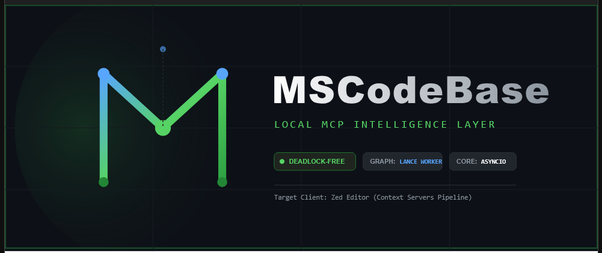

<p align="center">
  
</p>

[🇬🇧 English](../en/INSTALL.md) • [🇷🇺 Русский](../ru/INSTALL.md) • [🇨🇳 中文](INSTALL.md)

# 安装 MSCodebase Intelligence

> 翻译：2026-11-08，来源 docs/en/INSTALL.md。英文版为准。

> 2026-11-08 重写。本服务器是一个本地 MCP 服务器。**OpenCode 是主要宿主**；
> Zed 扩展仍然受支持。模型下载是可选的 —— 默认安装是文本优先的，不需要
> embedding、GPU 或网络。

---

## 1. 环境要求

| 组件 | 要求 |
|---|---|
| 操作系统 | Windows 10+（已验证平台）、Linux（CI）、macOS |
| Python | **3.14+**（仅测试过 3.14） |
| 内存 | 4 GB；启用本地模型时 8 GB+ |
| 磁盘 | 不含模型约 500 MB；含 GGUF 模型最多约 2 GB |
| 宿主 | OpenCode（主要）或 Zed，或任意 MCP 客户端 |
| 可选 | LM Studio / Ollama / llama.cpp，用于 rerank 和 legacy dense 路径 |

开发机上不需要 Docker 和 WSL。容器构建是一种部署选项（`deploy/docker/`）。

## 2. 完整安装

```bash
cd <repo-root>
python install.py          # interactive: venv, pip, optional llama.cpp + models
```

Windows 还有 `install.bat`；Linux/macOS 有 `install.sh`。安装器会：

1. 检查 Python 与环境；
2. 创建/更新虚拟环境并安装依赖；
3. 可选地下载 llama.cpp 和 GGUF 模型；
4. 把代码复制到扩展安装目录；
5. 写出 `uninstall.bat`。

没有模型时服务器仍能回答代码问题 —— 搜索会回落到 SQLite FTS5/BM25 加图。

## 3. 更新循环（最容易出错的部分）

已安装的副本位于仓库之外：

```
%LOCALAPPDATA%\Zed\extensions\mscodebase-intelligence
```

该目录名是历史原因留下的；OpenCode 启动的是同一个 venv
（`…\venv\Scripts\mscodebase-mcp.exe -u -m src.main`）。因此：

```bash
python install.py --sync-only    # copy code, drop __pycache__, no pip/models
# then restart the host: the OpenCode session (or the Zed window)
```

`--sync-only`（别名 `--sync`）是每次源码改动后的快速路径。跳过重启会让旧进程继续
运行；跳过同步则安装位置里仍是旧代码。两者都必须做。

## 4. 连接宿主

**OpenCode** —— 声明一个指向已安装 venv 的本地 MCP 服务器：

```jsonc
"mcp": {
  "mscodebase-intelligence": {
    "type": "local",
    "command": ["<ext-dir>/venv/Scripts/mscodebase-mcp.exe", "-u", "-m", "src.main"],
    "environment": {
      "PYTHONPATH": "<ext-dir>",
      "PROJECT_PATH": "${workspaceRoot}",
      "PYTHONUTF8": "1"
    }
  }
}
```

**Zed** —— 扩展读取同一目录；除扩展本身外无需额外配置。

**Claude Code / VS Code / Cursor** —— 从 `adapters/clients/` 复制配置形状，填入
venv 路径、仓库路径和项目路径。完整矩阵见 [CLIENTS.md](CLIENTS.md)。

## 5. 验证

在 agent 面板中按以下顺序执行：

```
tool_help()                                   # profile + visible/hidden tools
get_health_report()                           # index, providers, resources
codebase(action="index", path="status")       # chunks > 0?
```

如果文本索引缺失或过期：

```bash
python scripts/reindex_text_only.py --project .   # chunks + graph, no embeddings
python scripts/rebuild_graph.py                   # graph only
```

然后重启服务器，让新进程打开重建后的存储。本仓库的实测数字见
[FACTS.md](../FACTS.md)。

## 6. 可选 provider

| Provider | 用途 | 位置 |
|---|---|---|
| llama.cpp (GGUF) | 按需 rerank、legacy dense 路径 | `LLAMA_CPP_PORT` (8080)，reranker 8081 |
| LM Studio | 通过 HTTP 提供 embedding/rerank | `LM_STUDIO_HOST:1234` |
| Ollama | 通过 HTTP 提供 embedding/rerank | `OLLAMA_HOST:11434` |
| basedpyright | 六个 `lsp_*` 工具 | PATH 或扩展 venv |

默认的文本优先答案不需要其中任何一项。Provider 设置见
[CONFIGURATION.md](CONFIGURATION.md)。

## 7. 卸载

```bash
./uninstall.bat             # Windows
python install.py --uninstall
```

这会移除已安装的扩展副本。`%LOCALAPPDATA%/mscodebase/` 下的项目数据和项目的
`.mscodebase/chunks.db` 是分开的；如需彻底干净，请手动删除它们。

## 8. 故障排查

| 症状 | 可能原因 |
|---|---|
| 预期工具不出现 | `core` profile —— 运行 `tool_help()`，切换到 `full` |
| 任何查询都“未找到” | 索引为空 —— 检查 `codebase(action="index", path="status")` |
| 新代码没有生效 | 未执行 `--sync-only` 和/或未重启宿主 |
| 服务器启动后工具超时 | provider 或 LSP 卡住 —— 见 [GRACEFUL_DEGRADATION.md](GRACEFUL_DEGRADATION.md) |
| Windows 控制台窗口闪烁 | subprocess 未使用 `CREATE_NO_WINDOW` —— 见 [ZED_WINDOWS_QUIRKS.md](ZED_WINDOWS_QUIRKS.md) |
